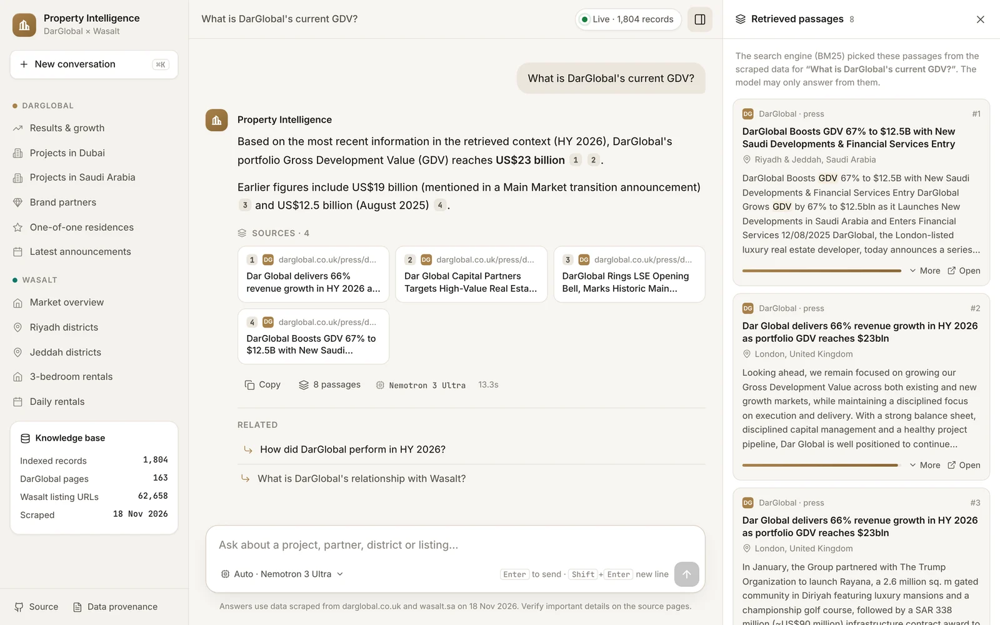
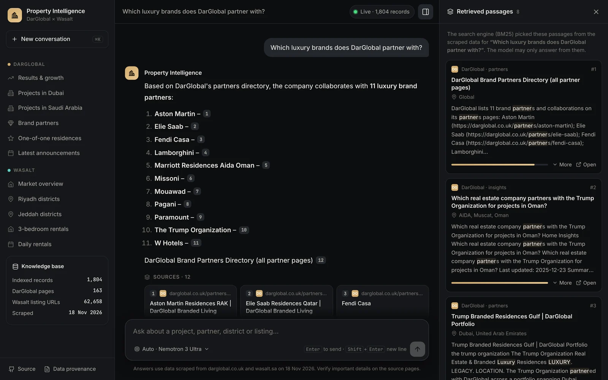
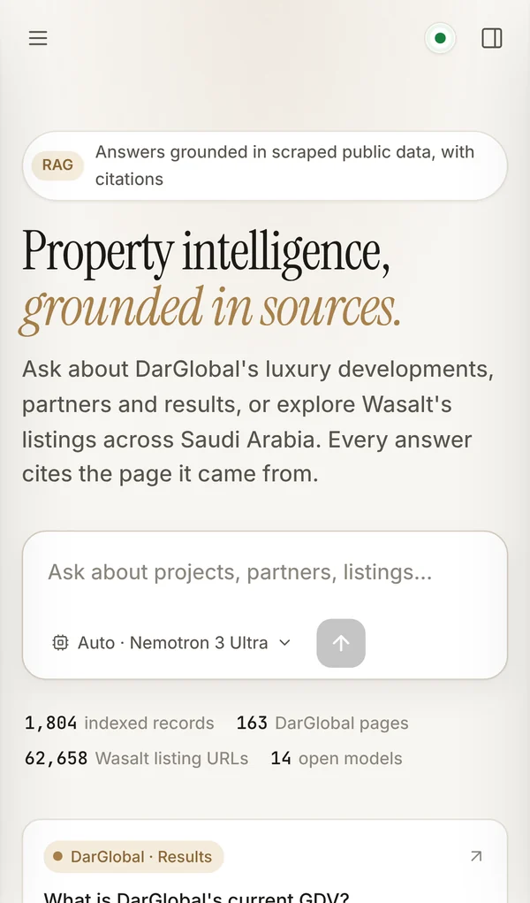
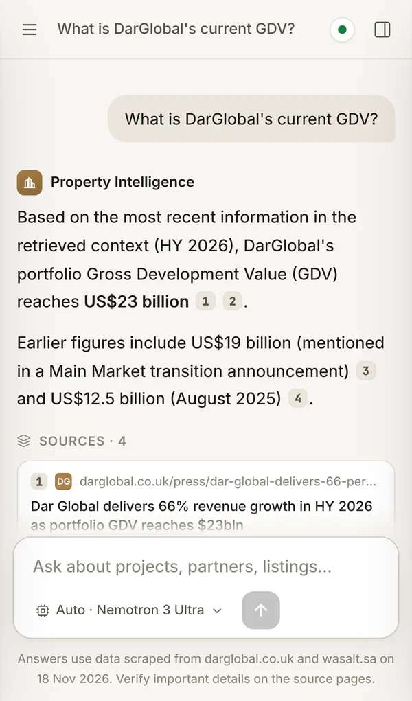
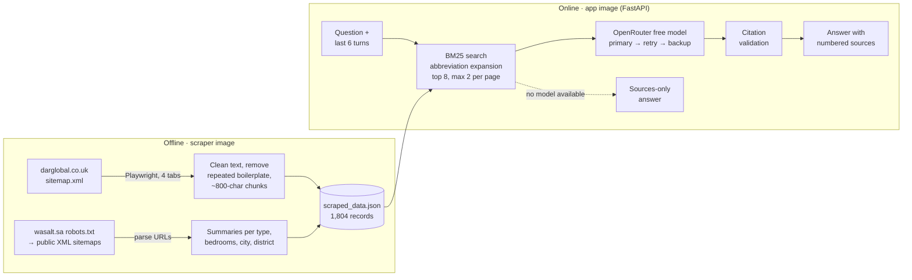

<div align="center">


# DarGlobal × Wasalt Property Intelligence

**An AI assistant for luxury developments and the Saudi property market, grounded in data scraped from both companies' public websites. Every answer cites the page it came from.**

[](https://github.com/KhajaRaheelAhmedMohiuddin/darglobal-wasalt-ai-chatbot/actions/workflows/ci.yml)
[](https://darglobal-wasalt-ai-chatbot.onrender.com)


[](LICENSE)

[**Live demo**](https://darglobal-wasalt-ai-chatbot.onrender.com) · [How it works](#how-it-works) · [Run locally](#run-locally) · [Data provenance](DATA_PROVENANCE.md)



</div>

## For reviewers

| | |
|---|---|
| **Try it** | Open the [live demo](https://darglobal-wasalt-ai-chatbot.onrender.com); nothing to install. It runs on Render's free plan, which sleeps after 15 minutes without visitors, so **the first load can take about a minute**. |
| **Questions to try** | "What is DarGlobal's GDV?" · "Who does DarGlobal partner with?" · "Which districts in North Riyadh have villas for sale?" · "What is the price of Wasalt listing #5907931?" *(not in the data, so it says so)* · "Tell me about The Astera", then "When is handover?" *(follow-up)* |
| **Check the build** | The [Actions tab](https://github.com/KhajaRaheelAhmedMohiuddin/darglobal-wasalt-ai-chatbot/actions) runs 42 tests, builds the Docker image and checks the container responds, on every push. |
| **Run it yourself** | Get a free key at [openrouter.ai](https://openrouter.ai), put it in `.env` (see `.env.example`), run `docker compose up --build`, open <http://localhost:7860>. |

### The assessment, step by step

| Step | Delivered |
|---|---|
| 1. Scrape public data | [`app/scraper.py`](app/scraper.py): headless-browser crawl of **163 DarGlobal pages** and parsing of **Wasalt's public XML sitemaps** (62,658 listing URLs, 8,634 category pages) into **1,804 searchable records** |
| 2. AI chatbot on the data | Retrieval-augmented generation: BM25 search over the records, then the model answers **only** from the retrieved text, with validated source links |
| 3. Free OpenRouter model | The strongest available `:free` model is chosen automatically at startup, with a second free model as backup; paid models are blocked |
| 4. Containerised | [`Dockerfile`](Dockerfile) (non-root, health check), [`docker-compose.yml`](docker-compose.yml), separate scraper image |
| 5–6. Deployed, working URL | Docker web service on Render: **https://darglobal-wasalt-ai-chatbot.onrender.com** |

## Highlights

- **Grounded, not guessed.** Answers come only from scraped passages. Every link is checked against the retrieved sources, and invented links are removed. If the data doesn't contain the answer, the bot says *"I don't have that information"*.
- **Transparent retrieval.** A side panel shows the exact passages each answer was built from, with relevance scores and highlighted terms.
- **Numbered citations.** Inline markers (¹ ²) and source cards link straight to the original DarGlobal or Wasalt page.
- **Follow-up questions.** The conversation is passed along, so "When is handover?" after "Tell me about The Astera" just works.
- **Resilient.** Primary model → retry → backup model → a clearly labelled sources-only answer. It never fails with a blank error, even when the free quota runs out.
- **Production touches.** Answer cache, per-visitor rate limiting (spoof-proof behind proxies), paid-model blocking, input validation, gzip, a non-root container and CI.
- **Polished interface.** Light and dark themes follow the device, it works on phones, and it's a single HTML file with no build step.

<table>
  <tr>
    <td width="62%"></td>
    <td width="19%"></td>
    <td width="19%"></td>
  </tr>
  <tr>
    <td align="center"><sub>Dark theme follows the device setting</sub></td>
    <td align="center" colspan="2"><sub>Designed for phones too</sub></td>
  </tr>
</table>

## How it works



**What happens when you ask a question**

1. **Search.** The question (plus the previous question, for short follow-ups) is expanded with domain synonyms (GDV → gross development value, 3BR → 3 bedrooms, RAK → Ras Al Khaimah) and ranked with BM25 over 1,804 records. Exact listing IDs jump to the top, pages whose address matches the question get a boost, and no page contributes more than 2 passages, so answers draw on several sources.
2. **Answer.** The top 8 passages go to the model with strict rules: use only this context, cite a source for every statement, prefer the most recent figure when sources disagree, and refuse when the answer isn't there.
3. **Verify.** The server checks every link in the answer against the retrieved pages, removes any it can't verify, and appends the consulted sources if an answer has none.
4. **Show.** The page renders the answer with numbered citations and source cards, and shows the retrieved passages in a side panel.

### Design decisions

| Decision | Why |
|---|---|
| **BM25 instead of embeddings** | A small corpus full of exact names (DG1, Astera, district names, listing IDs), where keyword matching is precise. It needs no embedding API, GPU or model download, so the image stays small and starts in seconds. |
| **Wasalt via sitemaps** | Wasalt's pages sit behind a Cloudflare challenge. Rather than bypass it, the scraper uses the public sitemaps Wasalt lists in `robots.txt` for crawlers, and documents what that can't provide (prices, descriptions). |
| **Model chosen at runtime** | Free models change often. The app reads OpenRouter's live list at startup and scores free models by size, instruction tuning and context length, so it never depends on a model that has been retired. |
| **Server-side citation checks** | Prompts alone don't stop a model inventing sources; validating links against the retrieved pages does. |
| **Single-file UI** | No build step or framework to maintain: one HTML file with vendored `marked` and `DOMPurify`, about 20 KB when compressed. |

## Data

Scraped on **18 November 2026**. Method, coverage, limitations and terms of use are documented in [DATA_PROVENANCE.md](DATA_PROVENANCE.md).

| Source | Method | Result |
|---|---|---|
| **DarGlobal** | Headless Chromium over English pages from `sitemap.xml`: projects, partners, one-of-one residences, press, insights, about, FAQ, investor | 163 pages → 835 chunks |
| **Wasalt** | Public XML sitemaps listed in `robots.txt` | 62,658 listing URLs + 8,634 category URLs → 969 summary records |

**Known limitations.**
- Wasalt prices and descriptions aren't included, because they appear only on the protected listing pages.
- Wasalt listing URLs don't carry the city, so city and district questions are answered from Wasalt's category pages instead.
- DarGlobal blog posts and Arabic pages weren't scraped.
- The data is a snapshot; re-run the scraper to refresh it.

## Tech stack

| Layer | Technology |
|---|---|
| Scraping | Playwright (headless Chromium), httpx, BeautifulSoup |
| Retrieval | `rank_bm25` with custom tokenisation and abbreviation expansion |
| Generation | OpenRouter free models (currently NVIDIA Nemotron 3 Ultra, with Google Gemma 4 31B as backup) |
| Backend | Python 3.11, FastAPI, Uvicorn, Pydantic |
| Frontend | Vanilla HTML/CSS/JS, `marked`, `DOMPurify` |
| Infrastructure | Docker, Docker Compose, Render, GitHub Actions |

## Run locally

Requirements: Docker Desktop and a free OpenRouter API key.

```bash
cp .env.example .env    # then set OPENROUTER_API_KEY=sk-or-v1-...
docker compose up --build -d
```

Open <http://localhost:7860>; check status with `curl http://localhost:7860/api/health`.

<details>
<summary>Without Docker (Python 3.11+)</summary>

```bash
pip install -r requirements.txt
uvicorn app.main:app --port 7860
```
</details>

<details>
<summary>Refresh the scraped data</summary>

```bash
docker compose --profile scraper run --rm scraper
```

Takes about 4 minutes and **replaces** `app/data/scraped_data.json`. Restart the app afterwards.
</details>

## Tests

```bash
pip install -r requirements.txt -r requirements-dev.txt
python -m pytest -v
```

**42 tests** cover:
- search quality: GDV, partners, bedrooms, projects, districts and listing IDs;
- the API: success, cache, backup model, graceful degradation, daily-quota handling, input validation and rate limiting;
- citation validation and follow-up conversations;
- security: paid-model blocking and spoofed proxy headers;
- the scraper's URL parsers.

OpenRouter is mocked, so no key or network is needed. [CI](.github/workflows/ci.yml) runs them on every push, then builds the Docker image and smoke-tests the container.

## Deploy

**Render.** [`render.yaml`](render.yaml) is a ready Blueprint: choose **New → Blueprint**, connect this repository and enter `OPENROUTER_API_KEY` when asked. Alternatively, create a **Web Service** with the **Docker** runtime and add the key under **Environment**. To redeploy automatically on every push, connect your GitHub account in the service's **Build & Deploy** settings; otherwise use **Manual Deploy**.

**Any Docker host** works the same way: build the `Dockerfile`, set `OPENROUTER_API_KEY`, and expose the port in `PORT` (default 7860).

<details>
<summary>Configuration</summary>

| Variable | Default | Purpose |
|---|---|---|
| `OPENROUTER_API_KEY` | none (required for AI answers) | Injected at runtime, never stored in the image |
| `OPENROUTER_MODEL` | auto | Force a specific free model |
| `OPENROUTER_FALLBACK_MODEL` | auto | Force a specific backup model |
| `RATE_LIMIT_PER_MINUTE` | 15 | Questions per visitor per minute |
| `TRUSTED_PROXY_HOPS` | 1 | Hosting proxies in front of the app; the visitor IP is read from that position at the right of `X-Forwarded-For` (0 = ignore the header) |
| `ANSWER_CACHE_TTL_SECONDS` | 21600 | How long identical answers are reused |
| `PORT` | 7860 | HTTP port |

OpenRouter allows 50 free-model requests per day on accounts without credits, or 1,000 per day once $10 of credits have been added (free models still cost nothing). When the daily quota is used up, the app pauses AI calls for 30 minutes and serves clearly labelled sources-only answers.
</details>

<details>
<summary>API</summary>

| Endpoint | Description |
|---|---|
| `GET /` | Chat interface |
| `POST /api/chat` | `{"message": "...", "history": [{"role": "user" \| "assistant", "content": "..."}]}` → `{reply, model_used, citations, retrieved_chunks, ...}` |
| `GET /api/health` | Status, record count, selected models, whether a key is configured |
| `GET /api/models` | Free models discovered from OpenRouter |
| `GET /api/knowledge` | The full scraped knowledge base |
</details>

## Project structure

```
app/
  main.py                FastAPI app: retrieval, prompt, model selection, fallback, cache, rate limit
  scraper.py             DarGlobal (Playwright) and Wasalt (sitemap) scraper
  static/index.html      Chat interface (single file, no build step)
  data/scraped_data.json Scraped knowledge base (1,804 records)
tests/test_app.py        42 automated tests
Dockerfile               App image (non-root, health check)
Dockerfile.scraper       Scraper image (Playwright + Chromium)
docker-compose.yml       App service + optional scraper profile
render.yaml              Render Blueprint
DATA_PROVENANCE.md       Data method, coverage, limitations, terms of use
SECURITY.md              Secrets handling and protections
```

## Roadmap

- Hybrid retrieval (BM25 + embeddings) with a re-ranker for paraphrased questions
- Arabic support: scrape the Arabic pages and add Arabic tokenisation
- Scheduled re-scraping (for example a nightly GitHub Action) with change detection
- Wasalt prices and listing details through an authorised API or data feed
- Streaming answers and persistent conversation history

## License and disclaimer

The code is released under the [MIT License](LICENSE). The scraped content in `app/data/` belongs to DarGlobal and Wasalt respectively, is not covered by that licence, and was collected solely for this assessment (see [DATA_PROVENANCE.md](DATA_PROVENANCE.md)). This is an independent project and is not affiliated with or endorsed by DarGlobal or Wasalt.
